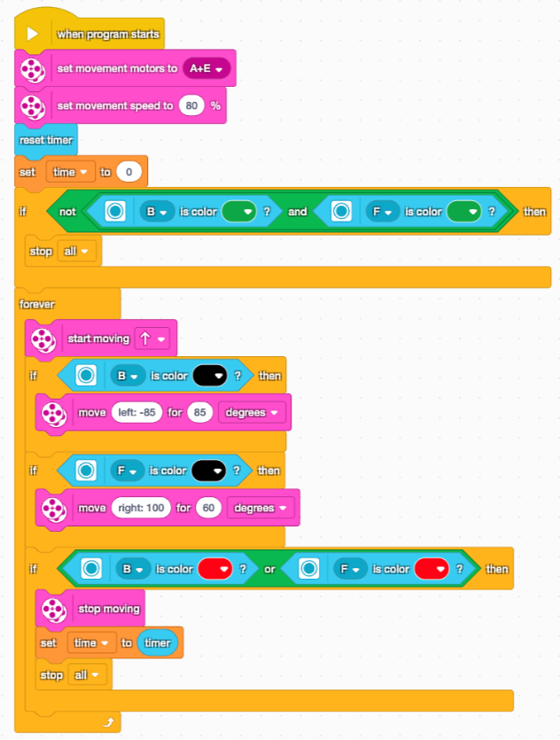

# Line-Following Robots: Student Guide

<!-- CLASS-SPECIFIC: assumes LEGO SPIKE Prime robots and a race against classmates. See CLASS-SPECIFIC.md. -->

You'll take a SPIKE Prime robot from "dumb" hand-written steering all the way to a self-taught AI driver, race it against your classmates, and understand every number that makes it work. All the code lives in this folder, opened in VS Code.

<!-- CLASS-SPECIFIC: the three-stage structure (one-sensor, two-sensor race, AI) is this class's sequence. See CLASS-SPECIFIC.md. -->

## What you'll build, in order

1. **One-sensor line following** — the simplest possible robot, written by you.
2. **Two-sensor line following** — a smarter robot that tracks both edges of the track, tuned for a speed competition.
3. **AI-trained line following** — a neural network that *evolves* its own driving through simulated natural selection, then gets copied onto your real robot.

---

<!-- CLASS-SPECIFIC: hardware: motor ports A/E, sensor port F, the Pybricks editor, tape-edged track with a linoleum floor lane. Students in the class actually build with the SPIKE app's blocks. See CLASS-SPECIFIC.md. -->

## Stage 1: One-sensor line following (you write this)

**The track:** two strips of black tape mark the edges, and the floor between them (e.g. linoleum) is where you're supposed to drive. Light reading = you're safely over the floor. Dark reading = you've drifted onto a piece of tape.

**The idea:** mount one color sensor near the front of your robot, riding along *one* edge of the track (pick either strip of tape). Since one sensor can't tell you how far off you are, the simplest strategy is: if you can't see the tape, steer toward it; if you're touching the tape, steer away from it. Constantly alternating makes the robot weave right along that one edge.

Wire one motor to Port A, one motor to Port E, and one color sensor to Port F. In the Pybricks editor, write a loop that:
1. Reads the sensor's `reflection()` value (0-100, lower = darker).
2. If it's *above* some threshold (start around 30), the sensor is over the floor — steer toward the tape.
3. If it's below that threshold, the sensor is over the tape — steer away from it.
4. Repeat forever.

Try it, watch it weave, and tune your threshold and turn sharpness until it reliably hugs the edge. This is the exact same idea Stage 2 builds on — you're about to make it a lot more robust.

---

<!-- CLASS-SPECIFIC: hardware: ports A, E, F and B, the Pybricks Python file, the 10-inch-wide track, sensor spacing, the speed race. The class's students build this stage as a block program, with Python much later. See CLASS-SPECIFIC.md. -->

## Stage 2: Two-sensor line following + race

Open **`spike_line_follower_baseline.py`** in VS Code. This is a complete two-sensor robot: one color sensor rides the left edge of the track, one rides the right edge, and the robot steers based on which one (if either) touches its tape:

- Both sensors over the floor → drive straight.
- Left sensor hits the tape → you've drifted left → steer right.
- Right sensor hits the tape → you've drifted right → steer left.

Read through `decide_turn()` in that file — it's short, and it's the whole brain of this robot.

<!-- CLASS-SPECIFIC: assumes students built a block program in Stage 2 (see images/stage2-decide-turn.png). See CLASS-SPECIFIC.md. -->

**Remember what you just did.** You created a **hand-written rule**: the program *you* wrote for your robot, where every block is a decision you made. Later you'll compare it with a brain that wasn't written by anyone but was *trained*.

**Wiring:** left motor → Port A, right motor → Port E, left sensor → Port F, right sensor → Port B. (These are the ports used in the block program too. If you plugged things into different ports, change the `Port` letters at the top of the file to match.) Mount the two sensors so they each ride near their own edge — close enough to reach the tape if the robot drifts, but normally sitting over the floor.

**Sensor placement (you're designing your own robot, so this is a real design decision):** for a 10-inch-wide track, mount your two sensors about **4.3 inches (≈14 studs) out from your robot's centerline** — so **~8.6 inches (≈27-28 studs) apart** total — leaving roughly 0.7 inches of margin before either sensor actually reaches its tape strip. Two ways to build that:

- A straight crossbar across the front of the chassis with a sensor at each end.
- Two shorter arms (~5 inches) angled outward at 60° from straight-ahead — a narrower, more compact build that reaches the same spacing.

This spacing is a *starting point*, not a fixed rule — it's about balance: sensors too close to center react late (you'll already be well off course before a sensor notices), sensors too close to the edge react to every tiny wobble (twitchy, oversteering). If your robot oscillates back and forth a lot, try pulling the sensors in a little. If it drifts off before correcting, push them out. Tuning this yourself is part of the design challenge.

**Calibrate before you race:** test `REFLECTION_THRESHOLD` on your actual floor/tape — the floor should read clearly above 30, the tape clearly below it. If the robot won't move or spins immediately, this is the first thing to check.

**Tune for speed.** Two constants control everything:
- `BASE_SPEED` — how fast the wheels drive forward.
- `TURN_STRENGTH` — how hard the robot corrects when it drifts (0 = no correction, 1 = a full pivot).

Push `BASE_SPEED` up and your robot goes faster but overshoots turns more. Push `TURN_STRENGTH` up and it corrects harder but can start zig-zagging. Finding the fastest *stable* combination is the whole game.

**Race it.** Whoever's tuned constants get around the track fastest without going off wins this round.

---

## Stage 3: Train an AI driver

Now you'll stop hand-tuning the steering rule and let a population of simulated cars evolve their own.

<!-- CLASS-SPECIFIC: assumes VS Code with the Python extension (the green Run Python File button). See CLASS-SPECIFIC.md. -->

### Run the simulation

1. Open **`menu.py`** in VS Code.
2. Run it (the green ▷ "Run Python File" button, top-right of the editor — or open a terminal with `` Ctrl+` `` and run `python menu.py`). A menu appears: **1) Train weights**, **2) Time trial**, **3) Start over**, **4) Rules vs weights**, **5) Glossary**, **6) Copy to Spike Robot Code** (you'll use that one much later). Choose with the 1–6 keys, arrow keys + Enter, or a mouse click. The box at the bottom of the menu shows your trained weights, how much training produced them, and whether your robot file has them yet.
3. Choose **1) Train weights**. A window opens showing 40 cars driving the track at once, each controlled by a tiny random "brain." Most crash immediately — that's expected. (Behind the scenes, every brain is also tested at faster speeds, 1.5× up to 3×, that you don't see on screen. Its fitness is the average across all of them.)
4. Watch the HUD in the top-left: generation number, how many cars are still alive, best fitness so far, best checkpoint count this generation.
   In the middle of the track a **Training progress** panel shows how you're doing: a chart of the champion's fitness (green) and the population average (blue), five speed boxes (1× to 3×) that turn green as the champion finishes a lap at each speed, and a lap progress bar. When all five boxes are green the panel says **SOLVED** — that's "done." If the champion hasn't improved for 15 generations it says **Plateau**; stop and train again. Unsure of a word? See the [glossary](glossary.md).
5. Every ~25 seconds, the surviving/farthest cars breed the next generation. Watch the population get better lap after lap.
6. **Read [`weights-explained.md`](weights-explained.md)** while this runs — it explains exactly what's inside a car's "brain" and how evolution is searching for good driving.
7. When you're happy with how it's driving (or bored of watching it improve), press **Esc** (or close the window).

### What happens when you stop training

The program automatically:
- Prints the winning car's 18 weight numbers to the terminal.
- Saves them to `best_weights.json` and adds this session to your training record.

Your robot file is **not** changed yet — you choose when, with **6) Copy to Spike Robot Code** (see below). That way you can time-trial your new weights first and only overwrite the robot's brain if they're an improvement.

If you want a better result, just run it again — training is random, so every run is a little different, and you can keep the best one.

### Time your trained car

Training tells you the cars got *better*; a time trial tells you *how good* your winner is. Choose **2) Time trial** from the menu. One car — driven by the weights in `best_weights.json` — starts on the green line, drives one lap, and the window shows its lap time. Press **R** to run it again or **Esc** to go back.

**Turn up the speed.** Use the **speed slider** at the bottom of the window (drag it with the mouse, or use the **left/right arrow keys**) to run from 0.5× up to 3× normal speed. Changing the speed restarts the lap. A faster lap is a better time — but the car can only turn so fast, so at high speed it swings wide on the corners and is more likely to leave the track. If it does, it gets no time. **More training means a higher safe speed:** a brain trained for only a generation or two may crash at 1.5×, while one trained for ten or more generations should finish every speed up to 3×, which is as fast as this car can turn the track's tightest corner. Try it — train a little, find the top speed where it still finishes, then train more and check again.

**Try it before you train.** If you haven't trained yet, the time trial runs an **untrained** car: random weights, a different brain every run (press **R** for a new one). Watch what happens. It is *not* a bad version of your Stage 2 rule. It has no decisions in it at all, so it steers by chance. That's where generation 1 of training starts. Compare it with your trained car afterwards. See "Rule, Untrained, Trained" in [`weights-explained.md`](weights-explained.md).

Other things that can end a run with no time: the car gets stuck circling without making progress (it stops after 15 seconds at normal speed), or it takes more than two minutes at normal speed. Both limits stretch at slower speeds, so a slow car gets proportionally longer.

The menu remembers your **best lap time at each speed** (a 1× lap and a 2× lap aren't comparable), even after you train again — so you can see whether new weights beat your old records. **3) Start over** deletes your trained weights and all best times (it asks you to confirm first) but doesn't touch `spike_line_follower.py`.

The clock counts simulated time, so the same weights always give the same time on any laptop. Retrain, re-time, and see if you can beat your own best.

### A track your car has never seen

Every car trains on **Track A**. In the time trial, press **T** to switch to **Track B**: a different shape, with squarer corners and a dent along the bottom, that no car has ever trained on. Your best times are kept separately for each track.

Try it:
1. Time trial your car on Track A at several speeds and note the fastest speed where it finishes.
2. Press **T** and do the same on Track B.
3. Compare. Is Track B slower? Does it crash at a speed that was fine on Track A?

If your car does worse on Track B, that's **training data bias**: the brain learned from one track, so it is better at *that* track than at line following in general. Compare with a classmate who trained for a different number of generations. Does more training on Track A help on Track B, or just on Track A? Discuss: what would you change about the training so the car copes with any track? (Hint: what could the cars practise on?)

### Rules vs. weights

Choose **4) Rules vs weights** in the menu to compare the rule you wrote in Stage 2 (your block program) with your trained brain. Toggle the sensors to see which block of your rule fires and how numbers flow through the network, then click a line in the network and use Up/Down to change one weight. See "Weights vs. Rules" in [`weights-explained.md`](weights-explained.md).

<!-- CLASS-SPECIFIC: hardware: copying a file onto a Pybricks hub, ports A, E, F and B. See CLASS-SPECIFIC.md. -->

### Put it on the robot

1. In the menu, choose **6) Copy to Spike Robot Code**. This writes your saved weights into the `WEIGHTS` list in `spike_line_follower.py`; the menu's box will say "spike_line_follower.py: has your saved weights" when it's done. Open the file to see the list change.
2. Copy the file's contents onto your SPIKE hub the same way you did for Stage 2.
3. Same wiring as Stage 2: left motor Port A, right motor Port E, left sensor Port F, right sensor Port B.
4. Same calibration: check `REFLECTION_THRESHOLD` still matches your floor and tape.

<!-- CLASS-SPECIFIC: the classmate race and comparing with the hand-tuned Stage 2 car. See CLASS-SPECIFIC.md. -->

### Race again

Compare your trained AI car to your hand-tuned Stage 2 car, and to your classmates' AI cars. Whoever's neural network evolved the best driving wins. Interesting question to think about: did the AI beat your hand-tuned version? Why or why not?

---

<!-- CLASS-SPECIFIC: the hardware rows (ports, REFLECTION_THRESHOLD) assume this class's robots. See CLASS-SPECIFIC.md. -->

## Troubleshooting

| Problem | Likely cause |
|---|---|
| Simulation window opens but nothing moves / cars instantly die | Sensor threshold or track lighting issue — this shouldn't happen with the provided code, ask your teacher |
| Robot doesn't move at all | Check motor ports match the file (A and E), check the battery |
| Robot spins in place immediately | `REFLECTION_THRESHOLD` is miscalibrated for your floor/tape — test each sensor's `reflection()` value on and off the track |
| Robot overshoots and zig-zags badly | `TURN_STRENGTH` (Stage 2) is too high, or the AI just didn't train well — try retraining |
| "Copy to Spike Robot Code" says it can't find `spike_line_follower.py` | Make sure it's in the *same folder* as `menu.py` |
