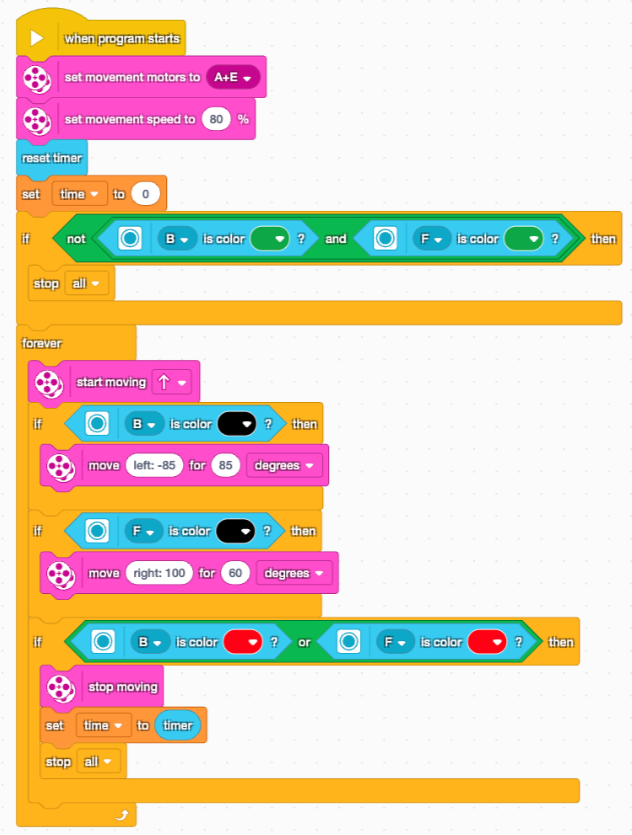

# What Are "Weights" in a Neural Network?

*A companion explainer for `line_follower_ai.py`*

## The Big Idea: A Weight Is Just a Volume Knob

Think of a weight as a knob that turns one piece of information up or down before it gets used. Turn it up (a big positive number) and that piece of information matters a lot. Turn it toward zero and it barely matters. Turn it negative and the network does the *opposite* of what that information suggests.

Every decision the line-follower car makes — steer left, steer right, hold straight — comes out of a bunch of these knobs multiplying against the car's two sensor readings. There's no "if left sensor is off, turn right" code anywhere in the program. There are just knobs, and *finding the right settings for all the knobs* is the whole project.

## The Car's Whole Brain, in One Sentence

The car's "brain" is a tiny network: **2 sensor readings in → 6 hidden neurons → 1 output out** (the steering turn). That's it — that's the entire brain. In `line_follower_ai.py`, this is the `NeuralNet` class.

- **Inputs (2):** the left edge sensor and the right edge sensor, each just reporting "on the track" (1) or "off the track" (0).
- **Hidden neurons (6):** each one looks at both sensors and does its own little calculation.
- **Output (1):** "how hard to turn".

Every arrow connecting those layers has its own knob — its own weight. Count them up: 2 inputs × 6 hidden neurons = 12 weights, plus 6 hidden × 1 output = 6 more. **18 weights total.** That's the entire brain — every decision the car will ever make comes from those 18 numbers.

## How One Neuron Actually Decides Something

Here's the whole math a single hidden neuron does:

1. Multiply each sensor reading by its own weight.
2. Add the results together.
3. Squash the total through a function called `tanh`, which forces any number into the range **-1 to 1**.

Say the left sensor reads `1.0` (on the track) and the right sensor reads `0.0` (off the track — the car has drifted left and lost the right edge). One neuron's weights might be `[-0.73, 0.69]`. Its calculation:

```
(-0.73 × 1.0) + (0.69 × 0.0) = -0.73
tanh(-0.73) ≈ -0.62
```

Do that same multiply-add-squash for all 6 hidden neurons, then repeat the process one more time using the hidden neurons' outputs to get the single output, the turn. Plugging those same two sensor readings all the way through one real (randomly generated) brain in the code produced a steering value of **turn ≈ 0.205** — a gentle turn back toward the track. Change the weights, and that same input would produce a completely different turn.

## Why Are the Hidden Neurons Different From Each Other?

All six hidden neurons do the *same kind* of calculation (multiply, add, squash), and they all look at the *same two sensors*. The only thing that makes one different from another is its **own pair of weights**. Neuron 1 might have `[+0.9, -0.2]` (it cares a lot about the left sensor and a little, in reverse, about the right). Neuron 2 might have `[-0.1, +0.8]`. Give them the same sensor readings and they produce different values, because their knobs are set differently.

That's why the six circles in the middle of the **Rules vs weights** page show six different numbers. Click one and the page shows its sum, its squashed value, and which weights it used.

Nobody decided what each neuron should "specialise" in. Evolution just kept the knob settings that drove well. Often they end up as rough detectors: one neuron lights up when the left sensor has lost the line, another when the right one has. Don't expect tidy labels, though. Some neurons end up near 0 and do very little.

## How Do the Hidden Neurons Make the Output?

The output (the turn) is a **vote count**. Each hidden neuron has one more weight, the **link** that connects it to the output. The steps:

1. A hidden neuron has a value between -1 and 1. That value is its *vote*.
2. Its link weight is the *volume and direction* of that vote. Multiply the two: `vote = value × link`. A positive vote pushes the turn **right**, a negative vote pushes it **left**.
3. Add up all six votes.
4. Squash the total with `tanh`. That's the turn the car actually steers with.

A neuron with a big value but a link near 0 has almost no say. A neuron with a small value but a large link can still matter. And a *negative* link flips the meaning: a high value from that neuron pushes the car **left**.

That's the whole relationship: hidden values are what the neurons "noticed", the links decide how much each one counts, and the output is the total.

## Weights vs. Rules: What's Actually Different?

<!-- CLASS-SPECIFIC: the Stage 2 program, its screenshot and the table's "Rule (your Stage 2 program)" heading. See CLASS-SPECIFIC.md. -->

In Stage 2 you wrote a **rule**: the program for your robot, with decisions like *if sensor B sees black, turn left.*



The trained car does the same job with no `if` at all. So what's the difference?

| | Rule (your Stage 2 program) | Weights (the neural network) |
|---|---|---|
| Who made it | You, by thinking about the problem | Evolution, by trying thousands of brains |
| What it looks like | A few readable decisions, one per case | 18 numbers, none of which means anything alone |
| Change one piece | Only that one case changes | Several answers shift at once, because every weight feeds many paths |
| Can you read why it works? | Yes, line by line | Only by running it and seeing what it does |

The car only has two sensors, each on or off, so there are just **four** situations: both on, left off, right off, both off. A good set of weights ends up answering those four situations the same way your rule does: left off → turn right, right off → turn left. The difference is *how it got there*. You told the rule what to do. The weights were never told: they were selected because cars with those numbers drove well.

See "Rule, Untrained, Trained" below for how a rule differs from an untrained brain.

That's also why a rule can't improve itself, but weights can. If the track or the speed changes, you have to rewrite the rule. With weights, you just train again.

**See it for yourself:** in the menu choose **4) Rules vs weights**. Flip the two sensors on and off and watch which line of the rule lights up, and how the numbers move through the network. The table at the bottom shows what each one decides for all four situations. Click a hidden neuron (one of the middle circles) to see its sum, its value and its vote. Then click a line in the network and press Up/Down to turn one knob, and watch several answers change at once. Try it with random (untrained) weights too: the rule is right every time, and the random brain often isn't.

## Rule, Untrained, Trained: Three Different Things

An **untrained** brain is not the same as a rule. They're alike in one way: neither one learns while it drives. They differ in where the decisions come from.

| | Where the decisions come from | How it drives |
|---|---|---|
| Rule (your Stage 2 program) | You, thinking about the problem and writing each decision | Correct for every situation, because you built it that way |
| Untrained brain | Nowhere: the 18 weights are random numbers | Steers by chance, often the wrong way |
| Trained brain | Evolution, which searched for weights that drove well | Good, often matching your rule's decisions without anyone writing them |

An untrained brain isn't a bad rule. It has no decisions in it at all. It has the same structure as a trained brain (2 sensors → 6 hidden neurons → 1 output), but the numbers mean nothing yet. It's where training starts: generation 1 is 40 of these.

You can see this on the **Rules vs weights** page with untrained weights: the rule is right every time, and the random brain often isn't.

In explore and exploit terms: the rule is knowledge *you wrote in*, the untrained brain has *none*, and the trained brain has knowledge it *found by exploring*.

**Think about it:** which is the better starting point for building a good robot, a rule you write or a random brain? When does the answer change?

## Finding the Right 18 Numbers: Evolution, Not Programming

Nobody writes down what the 18 weights should be — they start out completely random, which means a fresh car just wobbles and crashes almost immediately. So how does it learn?

The simulation runs a **genetic algorithm**, which works a lot like natural selection:

1. **Population:** 40 cars, each with its own random set of 18 weights, all try to drive the track at once.
2. **Selection:** whichever cars get farthest before crashing (or survive the longest) are the "fittest." Each brain is tested several times — at normal speed and again at faster speeds up to 3× — and its score is the average, so brains that hold the track at high speed rank higher.
3. **Breeding:** the best cars' weight lists get mixed together (like two parents' DNA combining) to make new cars.
4. **Mutation:** a few of the new weights get randomly nudged, so the population doesn't get stuck.
5. **Repeat**, generation after generation, until the weights reliably keep the car on the track — even at high speed. More generations means a brain that survives faster speeds.

*Why test at several speeds?* When we only tested brains at normal speed, they got worse at high speed the longer they trained: evolution kept fine-tuning for exactly normal speed. A brain only gets good at what it's scored on — this is called **overfitting**, and it's one of the most important ideas in machine learning.

The entire "brain" — the thing that's actually being trained — is just that flat list of 18 numbers, called the **genome** in the code (`self.weights`). Nothing else changes between generations. Evolution is just search: trying different combinations of 18 numbers until some combination happens to steer well.

## Why This Matters: Same Brain, Real Robot

Once the simulation finds a set of 18 weights that drives well, those numbers get printed and saved to `best_weights.json`. That file *is* the trained brain — nothing more.

To make the real LEGO SPIKE robot drive itself, you don't retrain anything on the robot. You just copy those same 18 numbers into the robot's code and run the exact same multiply-add-squash math, using its two real color sensors instead of simulated ones. Same weights in, same math, same steering decisions — just on a physical car instead of a simulated one.
